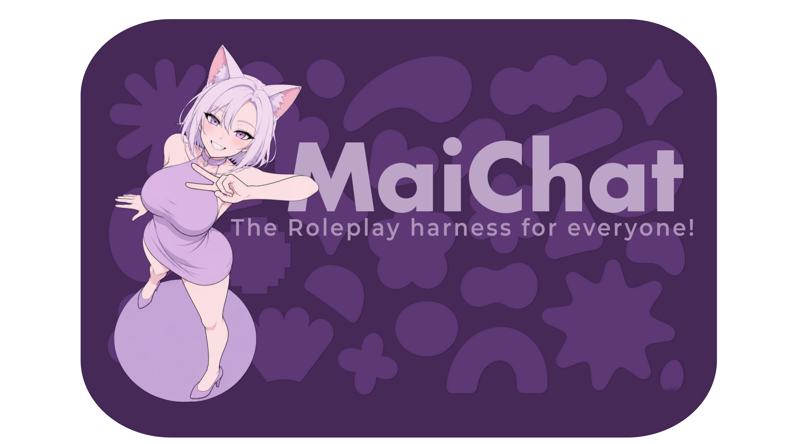
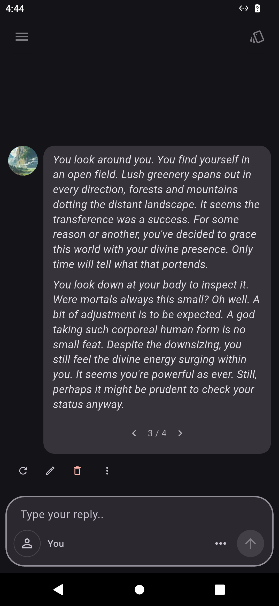
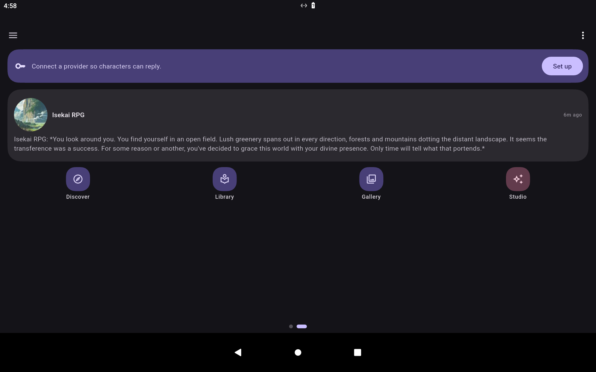
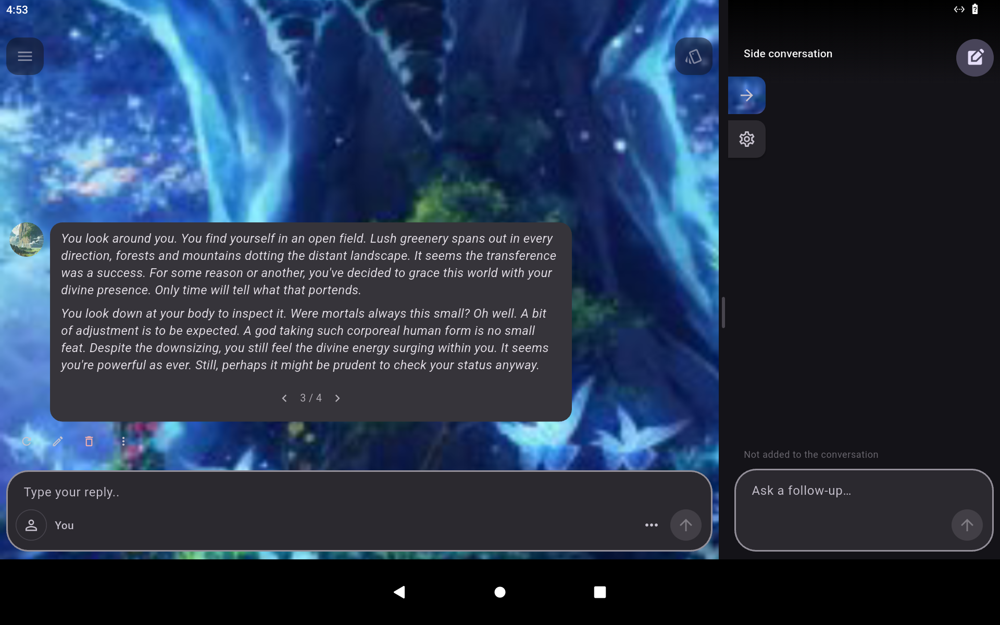
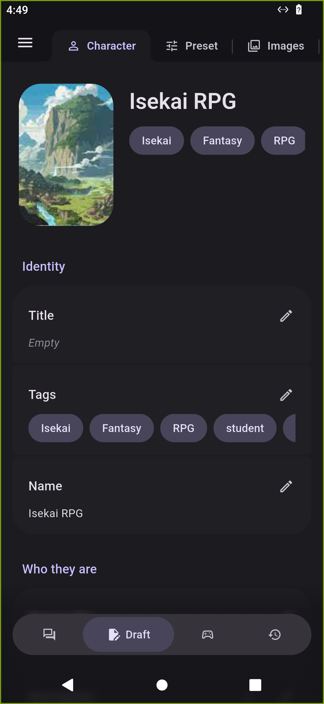
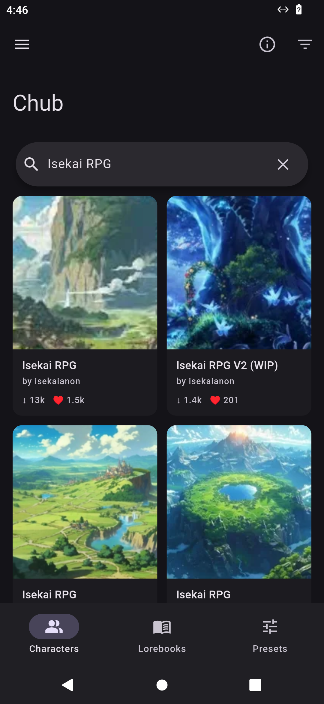
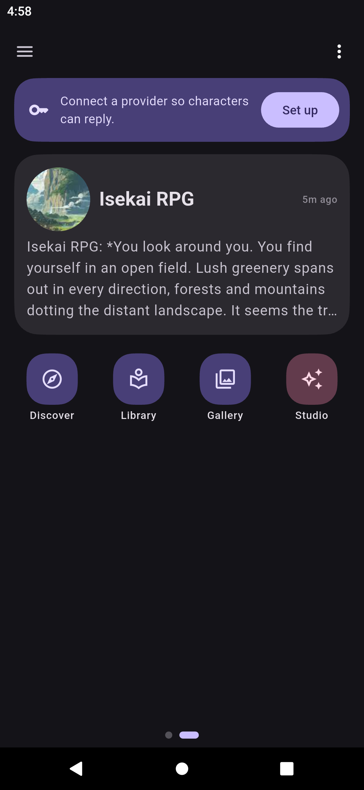
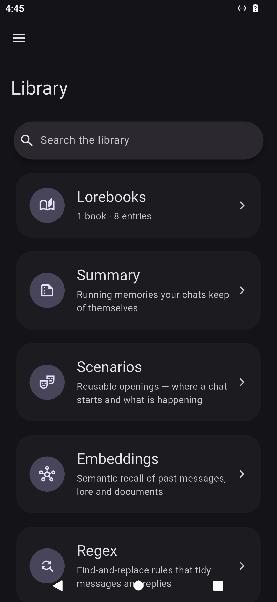
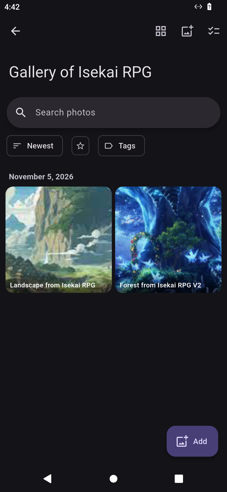

  

  
  
  

Download <b>MaiChat-1.19.4.apk</b> from the latest release and open it on Android.

MaiChat is a mobile-friendly universal roleplay harness built for enthusiasts and hobbyists.
The premise is simple, Sillytavern-class experience with the ease of material design.

This is a Flutter-based app inspired off of Agnaistic, RisuAI and Sillytavern, and contains features from all of them.

Regarding the name, Mai is the name of our mascot for our little app, be nice to her!

## Visuals

Dark-mode screenshots captured while using the Android app. <a href="developer%20notes/screenshots.md">How these screenshots are captured</a>.

## What's a Roleplay 'Harness?'

A Harness, is a gear strapped around the workhorse (in our case, LLMs). You can roleplay with an llm anywhere, but a harness allows you to better manage memories, character details and take your stories to the next level!

Below are why MaiChat becomes cozy in comparison to other frontends:

## Chat Interface, with more tools

The highly customisable Chat interface comes with Avatar windows to help you goon- I mean keep track of visuals much better. You can also float pictures from the character's gallery.

Along with this, we have added a new way to include OOC texts to steer your roleplay.

The /btw command allows you to make a side conversation with the roleplay harness, where you can give commands, order changes, ask queries, analyse stories, the possibilities are endless!

## Let AI make your characters

With the MaiChat's Agentic AI studio, you can also let the AI create characters, Lorebooks and scenarios, and edit presets.

Think of it like the major coding harnesses but reimagined for roleplay, that's what makes it special. Likewise, you can also use skills, web search and image generation to really upscale your characters.

## Or.. just search for characters?

With the Discover section, you can access to more than thousands of characters from various other popular roleplay frontends. You can not only download the characters, but also their attached Lorebooks! Seperate Lorebooks, if supported by the platform, are also available.

There's also a preset section but honestly nobody has made a site for it (in my knowledge) so I haven't added a preset site yet.

## Make the Homescreen for your own needs

Like an Android launcher, you can add in-app shortcuts, widgets and photos to keep track of your roleplays ALOT more better. You can have multiple screens aswell.

## Library for yourself

Lorebooks, Scenarios, Summaries, Embedding and Regex rules. These things have their own space for you to configure them quietly and nicely. No need of those clunky buttons anymore, Maichat let's you feel like it's your home, so you can create with full creative effort!

## Gallery to keep hold of images

There's a gallery too, you can store images for goon. Yeah that's the idea. It can come to your chats via float aswell.

## Compatible with Sillytavern, Agnaistic and more platforms.

Come at me with whatever supported backup file you've got, if it's not corrupted, Maichat can surely retrieve the supported data to life! You never have to start from scratch here. Like I said: a roleplay harness for EVERYONE.

## Connect with the Developer

I'm not a vibecoder, man, connect to me on my [GitHub](https://github.com/macareli) or my discord (username: Macareli.) to talk more about stuff. I love taking ideas. Star this repo if you think this is some cool stuff, although im not greedy ✌🏻

AI assistance has been taken though, you rlly can't ignore AI at this age. But I'm probably a heavy user of Maichat, so I think I'll keep updating it to fix around.

## For developers

Read the [developers-readme.md](developers-readme.md)
